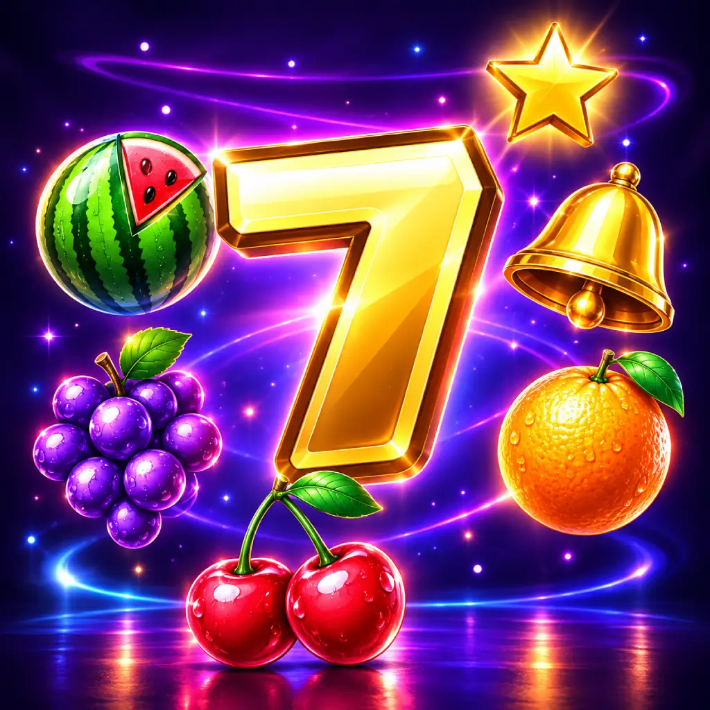
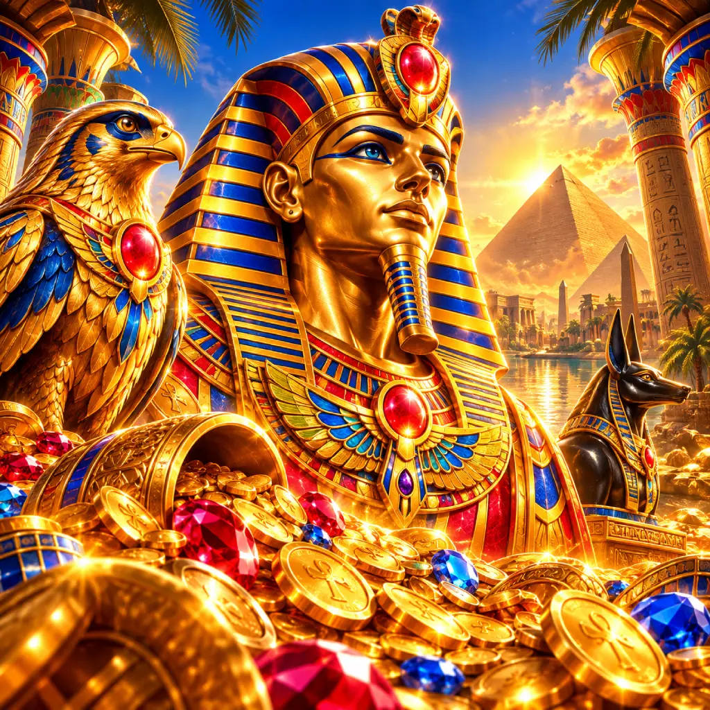

# Open Source Slots

Complete slot machine games, ready to play.

Slot maths is usually a closed box. The [slotopol](https://github.com/slotopol/server) project opened the first half of it by publishing reel strips and paytables for hundreds of games. This collection gives the other half: finished, playable slots built on that maths, each with its own art, sound and client, and a simulator that checks the published RTP.

Every game runs in the browser on its own. You can play it, read every line of it, check the numbers yourself, and use it as the starting point for your own. Code and sound are MIT, art is CC BY. New games join the list as they are finished.

## The games

| | Game | Layout | RTP | Play | Source |
|---|---|---|---|---|---|
|  | **STELLAR SEVENS** A classic fruit slot on three reels. No wild, no scatter, no free games, only three of a kind pays. Sevens are the top symbol and a full screen of them fills all five lines for the top win. | 3x3, 5 lines | 95.50% | [Play](https://apexslots.eu/games/stellar-sevens/) | [Code](stellar-sevens/) |
|  | **BUMPER CROP** A farm slot with avalanches. Winning symbols are harvested, the rest fall and fresh ones drop in, for as long as the field pays. Three tractors pay and open a five-floor barn ladder of prizes and multipliers. | 5x3, 25 lines | 95.55% | [Play](https://apexslots.eu/games/bumper-crop/) | [Code](bumper-crop/) |
|  | **GOLDEN PAPYRUS** An Egyptian book slot. The papyrus is wild and the scatter. Three start 10 free games on their own reels with one symbol drawn to expand: enough of it anywhere pays on all 10 lines at once. | 5x3, 10 lines | 95.11% | [Play](https://apexslots.eu/games/golden-papyrus/) | [Code](golden-papyrus/) |
|  | **NITRO HOT** A classic fruit slot on three reels. No wild, no scatter, only three of a kind pays. A full screen of plums, oranges, lemons or cherries doubles every line. | 3x3, 5 lines | 95.66% | [Play](https://apexslots.eu/games/nitro-hot/) | [Code](nitro-hot/) |
|  | **SCORCHING HOT** A classic fruit slot. No wild, no free games. Sevens are the top symbol, cherries pay from 2, and three or more stars anywhere pay the total bet on top of the lines. | 5x3, 5 lines | 95.66% | [Play](https://apexslots.eu/games/scorching-hot/) | [Code](scorching-hot/) |
|  | **PEARL REEF** A reef slot. The turtle is wild, doubles the wins it completes and is the top symbol. Clams pay anywhere and three start 15 free games on their own reels, where every win pays triple. | 5x3, 10 lines | 95.13% | [Play](https://apexslots.eu/games/pearl-reef/) | [Code](pearl-reef/) |
|  | **DISCOVERY VOYAGE** A voyage slot. The captain is wild and the top symbol. Three galleons start 10 free games on their own reels, where the galleon is wild as well. | 5x3, 10 lines | 95.02% | [Play](https://apexslots.eu/games/discovery-voyage/) | [Code](discovery-voyage/) |
|  | **HOUSE OF RA** An Egyptian slot. The sun disc is wild and the scatter. Three start 10 free games on their own reels where the best way on the screen expands over its reels and pays on every line. | 5x3, 10 lines | 95.18% | [Play](https://apexslots.eu/games/house-of-ra/) | [Code](house-of-ra/) |
|  | **FAIRYTALE** A storybook slot. The enchantress is wild and the top symbol. Three lanterns start 10 free games where, before every spin, one symbol is drawn and covers the first two or three reels whole, so every free game pays. | 5x3, 10 lines | 95.57% | [Play](https://apexslots.eu/games/fairytale/) | [Code](fairytale/) |
|  | **SAMURAI** A warrior slot. The samurai is wild and the top symbol. Three gongs pay and start 10 free games on their own reels, where a samurai anywhere on a reel turns the whole reel wild. | 5x3, 20 lines | 95.39% | [Play](https://apexslots.eu/games/samurai/) | [Code](samurai/) |
|  | **THE DYNASTY** A royal court. The monarch is wild and doubles the wins it completes. Two heirs call 25 to 45 free games on their own reels, where the other heir is crowned wild. | 5x3, 20 lines | 94.14% | [Play](https://apexslots.eu/games/the-dynasty/) | [Code](the-dynasty/) |

All of them are playable at [apexslots.eu](https://apexslots.eu).

## Run a game

Each game is its own project. Node 20 or newer.

    cd the-dynasty
    npm install
    npm run dev

Open the address Vite prints. `npm run build` writes the static bundle to `dist/`, `npm test` runs the engine tests.

## What is in every game

| Folder | What it is |
|---|---|
| `src/engine/` | The maths: reel strips, paytable, bet lines, the evaluator and the round. No graphics in here. |
| `src/game/` | The PixiJS client: reels, HUD, win presentation, game info screen, and the sound. Every game's soundtrack is synthesised in WebAudio, there are no audio files. |
| `src/sim/` | The proofs: exact enumeration and Monte Carlo in every game, and in most a closed-form par sheet and a reel strip check against the source yaml. |
| `tests/` | Vitest tests of the engine. |
| `slotopol/` | The reference maths the game was ported from, as published by slotopol (MIT), with their licence. The earliest ports carry no copy and name the slotopol file in their README instead. |
| `public/` | The art. |

Each game's own README has its paytable, rules, RTP and the exact commands that reproduce the figure.

## Licence

- Code: [MIT](LICENSE).
- Art (everything under each game's `public/`, and `tiles/`): [CC BY 4.0](LICENSE-ART.md). Use it anywhere, credit APEXSLOTS.
- Reference maths under a game's `slotopol/` folder, or a slotopol data file kept beside a game's code: MIT, copyright schwarzlichtbezirk, see the licence file next to it.

## Credits

The maths of these games was ported from [slotopol/server](https://github.com/slotopol/server) by schwarzlichtbezirk, MIT. The reel strips and paytables are theirs. The games, art, sound, clients and simulators are ours.
